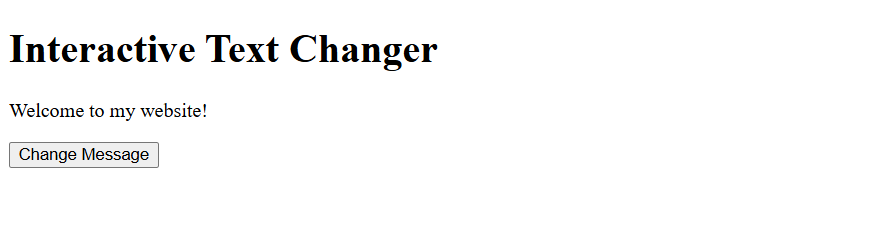
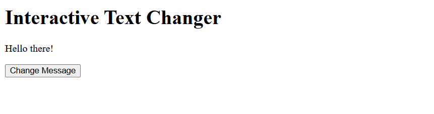
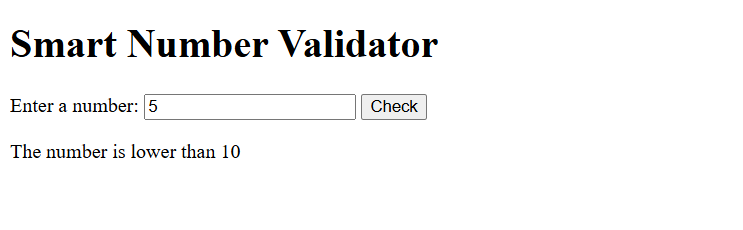
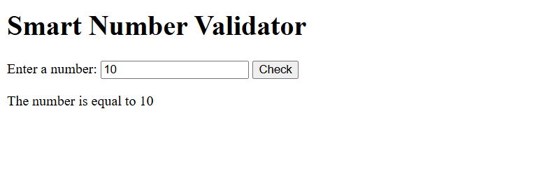
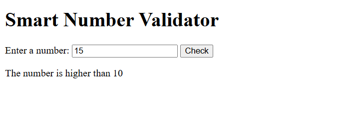
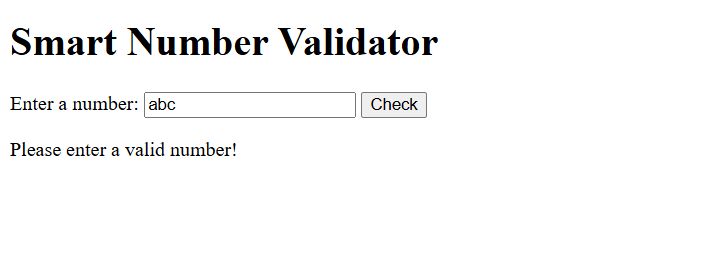
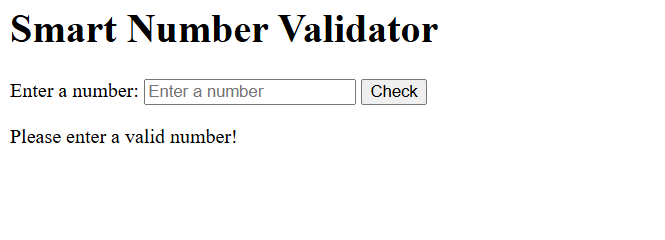
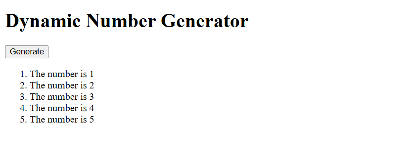

# bic21203-lab4a-javascript

Name: Tan Peck Shan
Matric No: AI240159
Course: BIC21203 Web Development

This repository contains the source code for Lab 4a. There are 3 folders, each folder represent each question in Lab 4a. Lab 4a has a total of 3 questions. In each folder, 2 files are included which are index.html and script.js.

For Q1,
1. Open Q1 folder.
2. Open index.html in a web browser.
3. Click the "Change Message" button.
Result: Message "Welcome to my website!" will change to "Hello there!"

For Q2,
1. Open Q2 folder.
2. Open index.html in a web browser.
3. Enter a number and click "Check".
Result: A message "The number is equal to/ lower than/ higher than 10 is displayed based on the input given. It also show "Please enter a valid number!" when the input is invalid.

For Q3,
1.Open Q3 folder.
2.Open index.html in a web browser.
3.Click "Generate" button.
Result: An ordered list from 1 to 5 is displayed.

